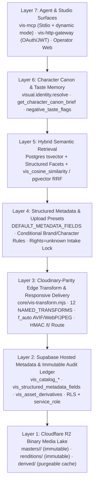

# Agentic DAM Blueprint 2026: Cloudinary-Parity Stack on Supabase + Cloudflare R2 + VIS MCP

> **Status:** ACTIVE REFERENCE ARCHITECTURE (`vis-mcp v2.1.0`)
> **Repository:** `frankxai/visual-intelligence` (MIT — public architectural contract; no raw binaries, no secrets, no workstation paths)
> **Control Plane:** VIS SQLite (`data/vis.sqlite`) + Supabase Postgres (`platform/migrations/`) + Cloudflare R2 (`starlight-media-private`) + `vis-media` Edge Worker (`workers/vis-media/`) + Dual-Transport MCP (`mcp/vis-mcp-server.mjs` & `mcp/vis-http-gateway.mjs`)

---

## 1. 7-Layer System Architecture



---

## 2. 1:1 Cloudinary Feature Parity Matrix

| Capability | Legacy / SaaS Cloudinary Pattern | VIS Sovereign Implementation | Module / Table / Route |
| :--- | :--- | :--- | :--- |
| **On-the-fly URL transforms** | `/image/upload/c_fill,w_1200,h_630,g_auto,q_auto,f_auto/...` | `/t/<sha256>/<canonical_spec>?exp=<unix>&sig=<b64url>` with 4096px / 16MP DoS guard | `core/vis-transform.mjs`, `workers/vis-media/src/index.js` |
| **Named transform presets** | Named transformations (`t_hero`) | 12 built-in `NAMED_TRANSFORMS` (`thumb`, `preview`, `hero_desktop`, `hero_mobile`, `og_card`, `avatar_sm`, `avatar_lg`, `lore_card`, `product_card`, `square_1080`, `cover_3000`, `lqip`) | `core/vis-transform.mjs` |
| **Automatic format & quality** | `f_auto`, `q_auto` + `Vary: Accept` | `negotiateFormat(f, Accept)` -> AVIF -> WebP -> JPEG + `Vary: Accept` | `core/vis-transform.mjs`, `workers/vis-media/src/index.js` |
| **Derived transformation cache** | Edge-cached derivatives | Content-hashed R2 cache at `derived/<sha2>/<sha>.<specHash16>.<ext>` with `X-VIS-Cache: HIT/MISS` | `workers/vis-media/src/index.js`, `vis_asset_derivatives` |
| **Safe derivative purge** | Invalidate derived assets only | `planDerivativePurge` + Worker `DELETE /o/derived/...`; `masters/` & `renditions/` return `403` | `core/vis-dam-layers.mjs`, `workers/vis-media/src/index.js` |
| **Responsive `<picture>` & `srcset`** | Responsive breakpoints | `buildResponsiveDeliveryManifest` emits AVIF/WebP/JPEG `<picture>` sources & signed `srcset` | `core/vis-transform.mjs`, `build_responsive_delivery` |
| **Structured Metadata & Rules** | Admin API metadata fields | Typed schemas (`string`, `integer`, `boolean`, `date`, `enum`, `set`) + conditional brand/character rules | `core/vis-dam-layers.mjs`, `vis_structured_metadata_fields`, `vis_asset_metadata` |
| **Upload Presets & Direct Presigned PUT** | Unsigned/signed upload presets | `DEFAULT_UPLOAD_PRESETS` + S3v4 `createR2PresignedUrl` with Issue #41 `rights_default='unknown'` lock | `core/adapters/cloudflare-r2-adapter.mjs`, `vis_upload_presets` |
| **Character & Identity Canon** | Tags / DAM custom models | `vis_character_profiles` + `vis_asset_character_links` + `visual.identity.resolve` + `get_character_canon_brief` | `platform/migrations/20261128_vis_dam_layers.sql`, `core/vis-dam-layers.mjs` |
| **Search & Vector Similarity** | Visual search API | Postgres `tsvector` + GIN JSONB facets + RRF vector scoring (`vis_cosine_similarity` / pgvector) | `core/vis-dam-layers.mjs`, `vis_catalog_rich_search`, `vis_asset_embeddings` |
| **Agent MCP Dynamic Mode** | `@cloudinary/asset-management-mcp --mode dynamic` | `VIS_MCP_MODE=dynamic` shrinks `tools/list` to 12 core + `dam_discover_tools` / `dam_describe_tool` | `mcp/vis-mcp-server.mjs` |

---

## 3. Infrastructure Economics (Zero Egress Media Lake)

- **Origin Binary Lake (Cloudflare R2 `starlight-media-private`):** **$0/GB egress**, ~$0.015/GB-month storage. Immutable content-addressed keys (`masters/<2hex>/<sha256>`) eliminate duplicate binary uploads across workspaces and campaigns.
- **On-the-fly Transform & Cache (`vis-media` Worker + `IMAGES` binding):** Cached hits read directly from `derived/` in R2 (`X-VIS-Cache: HIT`) without re-running image transformations.
- **Metadata, Governance & Search (Supabase Postgres):** Free/Pro predictable flat pricing for relational catalog records, immutable version triggers, append-only identity review ledgers, and vector embeddings.
- **Local-First Control Plane (`data/vis.sqlite`):** Zero cloud latency for creator workstations and offline agent sessions; PGlite tests validate Postgres migrations hermetically in CI without live cloud dependencies.

---

## 4. Non-Waivable Security & Issue #41 Human Gates

1. **Bucket Privacy:** `workers/vis-media/wrangler.jsonc` keeps `workers_dev: false` and `preview_urls: false`; `r2.dev` stays disabled. `resolvePrivateWorkerBase()` rejects `workers.dev`, `r2.dev`, insecure `http:`, and embedded credentials.
2. **Signed Edge Access:** Both `/r/<sha>/<kind>` and `/t/<sha>/<spec>` require valid non-expired HMAC-SHA256 signatures signed with `PREVIEW_SIGNING_KEY`.
3. **Immutable Masters & Renditions:** `PUT` to existing `masters/` or `renditions/` returns `409`; `DELETE` returns `403`. Only `derived/` and `test/` keys are purgeable.
4. **Rights Fail Closed:** All 5 `DEFAULT_UPLOAD_PRESETS` and Postgres `vis_upload_presets` CHECK constraints lock `rights_default = 'unknown'` and `approval_default = 'candidate'`.
5. **MCP Session Gates:** `mcp/vis-mcp-server.mjs` defaults to read-only (`VIS_ENABLE_WRITES`, `VIS_ENABLE_RIGHTS`, `VIS_ENABLE_PUBLISH` must be explicitly enabled by a human operator for a session). Hosted `mcp/vis-http-gateway.mjs` enforces RS256 JWKS verification, strict multi-tenant workspace isolation, and read-only projection.

---

## 5. Worker Transform & R2 Key API Reference

### URL Transform Grammar (`/t/<sha256>/<canonical_spec>`)
- **Preset expansion:** `t_<name>` expands any preset in `NAMED_TRANSFORMS`; trailing tokens override preset parameters.
- **Directives (normalized canonical order `c,w,h,ar,g,dpr,q,f,e,b`):**
  - `c_<fill|fit|scale|crop|pad|thumb|limit>`
  - `w_<1..4096>`, `h_<1..4096>`, `ar_<w:h>`
  - `g_<auto|center|face|north|south|east|west|north_east|north_west|south_east|south_west>`
  - `dpr_<1|1.5|2|3>` (total effective pixels `w*dpr * h*dpr <= 16,777,216`)
  - `q_<auto|10..100>`
  - `f_<auto|avif|webp|jpeg|png>`
  - `e_<grayscale|blur[:1..100]|sharpen[:1..10]>`
  - `b_<6-hex|transparent>`

### R2 Key Hierarchy
- `masters/<sha2>/<sha256>` — immutable original bytes (PUT verifies SHA-256)
- `renditions/<sha2>/<sha256>.<thumb|preview>.webp` — immutable operator review renditions
- `derived/<sha2>/<sha256>.<specHash16>.<ext>` — edge transform cache (purgeable)
- `test/...` — synthetic test namespace (purgeable)

---

## 6. MCP Client Registration Snippets

### Standard Full Mode (`mcp/vis-mcp-server.mjs`)
```json
{
  "mcpServers": {
    "visual-intelligence": {
      "command": "node",
      "args": ["mcp/vis-mcp-server.mjs"],
      "env": {
        "VIS_MCP_MODE": "full"
      }
    }
  }
}
```

### Progressive Discovery / Dynamic Mode (12 core tools + `dam_discover_tools`)
Recommended for Claude Code, Codex, Cursor, and Antigravity multi-MCP sessions to minimize prompt token overhead while keeping every VIS DAM tool callable via `tools/call`:
```json
{
  "mcpServers": {
    "visual-intelligence": {
      "command": "node",
      "args": ["mcp/vis-mcp-server.mjs"],
      "env": {
        "VIS_MCP_MODE": "dynamic"
      }
    }
  }
}
```
