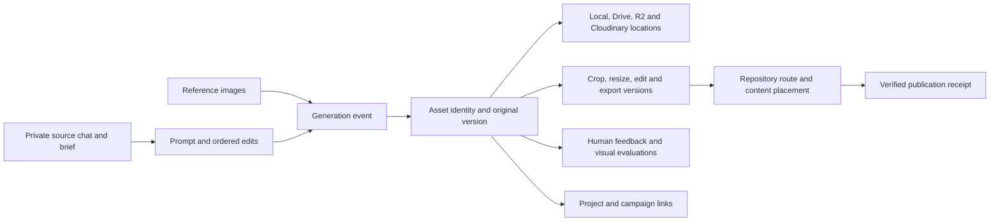

# ChatGPT, mobile, and cloud asset intake

Status: engineering proposal plus a working read-only coverage audit. Intake,
semantic ranking, cloud reconciliation, and automatic deployment are not implemented
by this change. Continue the existing VIS product and issue backlog.

## Outcome

From a phone or desktop, save an image and its creation context once. Later, ask
which project it fits, whether its original is downloaded and backed up, which
versions exist, which prompt/model created it, and where it is used. Prepare an
approved image for a website or content package without repeating that research.

VIS remains the asset identity and relationship graph. Watched-root, rendition and
storage work from issue #40 / PR #39 is already merged on main; preserve it before
adding an intake adapter. Drive can serve as a mobile inbox. The accepted delivery
contract is Vercel Blob or the product repo, with private R2 under its existing
gates. Cloudinary is an optional capability to evaluate within that contract.
An existing CMS-DAM export is a compatibility view; it cannot override measured VIS
facts. Store original bytes once per content hash and record all provider locations.

## What can be used now

The existing CLI has scanning, prompt sidecars, trace/packet commands, annotations,
feedback with an outbox, usage detection, derivative planning, and storage planning.
Those command names do not establish that a particular file was processed or that
an external service was connected. Inspect receipts and actual provider results.

Run the new read-only audit against an existing index:

```powershell
node scripts/asset-coverage.mjs --index <existing-vis.sqlite> --limit 8
```

It distinguishes record totals from asset coverage, reports index freshness, and
samples missing prompts with detected website references first. It opens SQLite
read-only in a snapshot transaction, refuses a missing/unsupported index, and does
not initialize, scan, migrate, upload, approve, or publish. Its JSON includes local
paths and historical provider/model labels; keep reports in private evidence.

## Sources and actual capability boundaries

| Entry point | Supported path | Evidence still needed |
| --- | --- | --- |
| ChatGPT Images | Save/download an original; mobile can share an image to another app | Original bytes, source conversation/message identity, context packet |
| ChatGPT Library | Browse/search/reuse saved files; connected Drive files retain their source | Do not assume there is a public bulk Images export API |
| Existing consumer chats | Capture the relevant chat directly or inspect a user-authorized export | Export coverage varies; verify included image bytes and message references |
| OpenAI API | Build an application that captures its own requests, responses, files, and generation settings | API conversations do not establish access to a consumer account's previous ChatGPT chats |
| ChatGPT connected apps | Use the file operations actually exposed in that session and account | A read connection does not establish arbitrary binary upload or unattended execution |
| Google Drive API | Upload originals and JSON sidecars; use resumable uploads for mobile/network interruption | OAuth scopes, destination folder ID, upload checksum, retry and reconciliation |
| Cloudinary | List/search/relate assets, store metadata, generate delivery variants | Plan entitlement, identity mapping, approval, stable delivery URLs and upload receipts |

One discovery session's Google Drive connector exposed native document
creation, search, and other file operations, but no generic binary-image upload
tool. The Cloudinary connector exposed image listing and upload. Availability in
another ChatGPT mobile conversation must be checked there. A generated image can
be sent directly to a DAM only when its bytes or an authorized retrievable file
reference are available to an actual upload action. A prompt requesting the upload
alone does not create that capability.

Official references, checked 2026-10-16:

- [Images in ChatGPT](https://help.openai.com/en/articles/11084440-chatgpt-image-library)
- [Library](https://help.openai.com/en/articles/20001052-using-library-to-manage-files-in-chatgpt)
- [ChatGPT export](https://help.openai.com/en/articles/7260999-how-do-i-export-my-chatgpt-history-and-data)
- [Google Drive app permissions](https://help.openai.com/en/articles/10929079-google-drive-app-and-setup-in-chatgpt)
- [API conversation state](https://developers.openai.com/api/docs/guides/conversation-state)
- [Drive uploads](https://developers.google.com/workspace/drive/api/guides/manage-uploads)
- [Drive changes](https://developers.google.com/workspace/drive/api/guides/manage-changes)
- [Drive custom properties](https://developers.google.com/workspace/drive/api/guides/properties)
- [Cloudinary asset identifiers](https://cloudinary.com/documentation/upload_parameters)
- [Cloudinary transformations](https://cloudinary.com/documentation/image_transformations)
- [Cloudinary visual search and plan restrictions](https://cloudinary.com/documentation/dam_visual_search)
- [Bynder asset metadata API](https://api.bynder.com/docs/getting-started)

## Mobile workflow

Use the existing Creative Vault and `00_INBOX_MOBILE`; preserve its folder IDs.
Save/share the selected full image into that inbox. Also capture a private context
packet from the creation chat. A conversation link alone is useful as a pointer,
but another session may not be able to open the private conversation.

Copy-ready request inside the original image chat:

> Prepare a private asset handoff for the images I select. Include the original
> prompt text, relevant edit instructions in order, project, intended use, source
> chat and image/message references if available, input/reference images, and my
> approval or rejection comments. Record model, provider, seed, and generation
> settings only when exposed; otherwise use null. Distinguish my words from your
> summary. Return an image-to-context mapping and downloadable context JSON. If an
> authorized upload action is available, save both into my existing private mobile
> inbox and report the resulting file IDs. Otherwise give me the image and context
> files to save there. Do not mark an upload complete without a provider receipt.

For repeat use, a mobile share target or authenticated upload form should accept
image + context + project choice, store a draft locally while offline, show each
file's progress, and resume by job ID. Preserve a submitted item through app closure.
This is a proposed extension to the existing cockpit, not a deployed phone feature.
Normal ChatGPT mobile capture can use the current app's Save/Share flow meanwhile.

## Provenance and the relationship graph



Keep the existing `.vis.provenance.json` schema. Its generation fields carry the
exact prompt, model/provider, seed, settings, and output paths; agent fields carry
thread/session references. Add intake context in a separately versioned manifest
or the permitted metadata object, rather than inventing incompatible top-level
fields. Unknown values remain null. Preserve any available C2PA/IPTC/EXIF payloads
and record extraction evidence, but absence of embedded metadata proves little.

An intake record needs source provider + item ID, chat/project/message IDs when
exposed, original filename, capture time, SHA-256, MIME type, measured dimensions,
source evidence and its confidence, private context reference, project candidates
with reasons, creator/model evidence, rights state, and intended use. Give each
edit/reference/derivative an explicit relationship to its parent. Do not infer the
exact model from a chat's displayed assistant name, a filename, or the current date.

The user's typed prompt and the effective image-tool request may differ. Preserve
both when exposed, label revised prompts separately, and never replace an original
with an assistant summary. A prompt/model/seed record improves traceability but
does not guarantee identical output from a later service/model revision.

One image can support multiple projects. Store many-to-many links with role and
confidence. Explicit user choice outranks chat/project evidence, which outranks
semantic suggestions. A file under an estate folder is insufficient evidence that
it belongs to the Starlight brand.

## Downloaded, processed, backed up, and used

These are independent records with their own timestamps:

| Fact | Required evidence |
| --- | --- |
| Discovered | Stable source item ID or captured source reference |
| Downloaded | Original bytes, SHA-256, file size, measured MIME/dimensions, verified location |
| Deduplicated | Exact content-hash match; retain every source/location link |
| Context linked | Correct image/message mapping and private context/sidecar reference |
| Enriched | Extraction/ranking result plus model, rubric, revision, confidence, and cost |
| Approved | Explicit scoped decision, actor, date, rights and brand/canon checks |
| Processed | A derivative record linking input hash, recipe/version, output hash and dimensions |
| Backed up | Destination object/file ID and confirmed checksum; sync alone is not a backup |
| Used in source | Repository, file/route, asset/version ID, revision and observed reference |
| Published | Deployment/publication URL and revision, verification date and result |

Store failures and retries alongside the stage, with `pending`, `running`,
`succeeded`, `failed`, and `needs-review` states as appropriate. A current presence
check and successful checksum comparison are needed before relying on an old scan.
Do not label every image in a `public` directory deployed. Missing publication rows
mean missing evidence, even if images are already visible on a site.

## Visual intelligence and taste

Separate measurable technical fitness from visual judgment. File size and WebP
encoding affect delivery fitness; they cannot rate composition or emotional fit.
Existing readiness scoring must be presented as readiness, with its flags visible.

Proposed per-image evaluations should inspect the image and record:

- Composition and focal hierarchy; crop safety and space for text.
- Brand and project fit, character/canon consistency where relevant.
- Lighting, materials, detail, authenticity, and visible generation defects.
- Originality and similarity to already-used assets.
- Suitability for the specific website slot, article, cover, or social format.

Keep each dimension and explanation visible. Record evaluator, model/version,
rubric hash, inspected asset version, reference set and uncertainty. Human ratings
and pairwise choices remain distinct from model predictions. Learn preferences
within brand/use-case scopes so one fantasy image rejection does not become an
estate-wide ban. Route new actual feedback through the existing feedback outbox
and taste ledger; synchronize memory with a receipt. Repeated policy text is not
new human preference data.

Use exact hashes for byte duplicates, perceptual hashes for candidate variants,
and image/text embeddings for semantic discovery. Embeddings do not establish
identity or rights. Suggested project matches and taste scores need evaluation on
an actual curated set. Cloudinary's documented visual search is an Enterprise
feature; the presence of its tool does not establish entitlement on a Free account.

For a first calibration, have the owner rank a small real selection for each
important project/use. Compare predicted pairwise choices with those decisions,
track rejection reasons, and retain disagreement. Do not present a model's generic
aesthetic score as the owner's taste. No competitive advantage is established yet.

## Storage, synchronization, and automation

Retain immutable originals and private context in the existing vault/archive
contract. Keep VIS SQLite local to its owning process. Do not live-sync an active
SQLite database across laptops through Drive; sync exported manifests/events or
use the existing planned central service after reconciliation. Other machines
keep their own location maps. Website repositories receive approved derivatives
or stable versioned delivery references, never the whole private chat archive.

The proposed processor extends the existing watched-root pipeline:

1. Discover source changes with a persisted cursor and bounded reconciliation.
2. Accept a complete upload, validate bytes, compute SHA-256 and measured metadata.
3. Upsert source identity and version, preserving duplicate source links.
4. Parse the context packet; flag ambiguity and missing originals.
5. Suggest projects, generate searchable descriptions/embeddings, and evaluate
   shortlisted images against actual brand references.
6. Present approval and repair choices. Generate approved target-specific variants.
7. Produce a website/content packet with asset/version, URL/path, alt-text draft,
   crop/focal point, source context reference and rights/approval evidence.
8. Record placement after source integration and live publication after verification.

Use a durable job table with unique `(source, source_item_id, content_hash,
stage, recipe_version)` keys, leased execution, retry counts, bounded backoff,
and a failed-item queue. Write partial downloads to temporary files, atomically
rename after validation, and commit success with its output receipt. Advance
provider cursors only after durable intake. Expired source URLs need a fresh
authorized reference, not blind retry. Resume without duplicating assets or
overwriting approved originals. Run a bounded manual job before proposing a schedule.

Private context may contain confidential material. Keep raw source chats private,
send only selected task-relevant context to processing providers, and keep API
credentials server-side. A cloud service should not receive a full chat archive
merely to classify an image. Do not store signed download URLs as durable identity.

## What established DAM products contribute

Cloudinary provides a relevant delivery alternative: stable asset IDs, structured
metadata, variants and delivery URLs. Bynder provides a useful reference for brand,
collection and metadata management. These official capabilities support the design
patterns above; they do not establish that every organization runs the same stack.

Compare the existing VIS + Drive + Cloudinary path against using Cloudinary alone
on the same real selection. Measure successful original retrieval, prompt/context
coverage, correct project assignment, useful search results, repair time, storage/
processing cost, mobile recovery and website placement effort. VIS should earn its
extra engineering through reliable cross-provider provenance and reuse. Eagle or
another catalog can remain a browsing adapter; avoid starting another DAM product.

## Delivery sequence and acceptance

1. Reconcile current VIS branches and existing library/storage work. Run the coverage
   audit and preserve freshness/unknowns. This change supplies that audit only.
2. Prove intake with selected real images: original download, sidecar/context link,
   correct project assignment, exact-duplicate retry and interrupted upload recovery.
3. Reconcile Drive and Cloudinary IDs to VIS, including files already downloaded.
   An unknown mapping must remain visible until verified.
4. Add source-chat context ingestion with per-image mapping and preserved unknown
   model/settings. Prove that one asset can have multiple edits and project links.
5. Add inspectable visual ranking and calibrated preference feedback. Evaluate on
   the owner's decisions and show where suggestions disagree.
6. Prepare one approved website placement and one content export. Verify output
   dimensions, crop, alt text, recorded version, actual source usage and live URL.
7. Verify the mobile workflow with offline capture, interrupted upload, retry,
   keyboard focus, touch targets and reduced motion before regular automation.

Tracked dependencies: #3 automation, #6 provenance, #14 Drive, #15 mobile, #19
semantic search, #20 storage/delivery, and #40 existing library work. Current issue
state must be inspected before implementation; older generated status files are
not current completion evidence. This proposal creates no scheduled job, new cloud
account, upload, model invocation, deployment, or publication.
