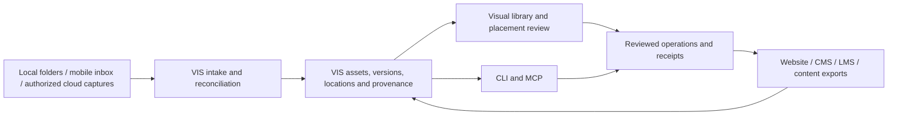

# The visual workspace

Use VIS as the asset catalogue and operator interface. Keep the existing library,
CLI and MCP implementation. Connect the CMS, LMS and publishing tools through
asset IDs and versioned placements. They should not each own another master copy.

## Open something useful

The existing cockpit can produce a private HTML snapshot:

```powershell
node bin/vis.mjs dashboard --read-only --verify-locations --limit 40 --output <private-output-directory>/asset-desk.html
```

Open that HTML file in a browser. Local previews refer to the original files on
this computer. Paths that no longer exist cannot preview. File paths, prompts and
internal source references can be embedded in the page. Keep it private; do not
deploy this export or use the public web build with a private catalogue.

The new Files and processing section shows the latest catalogue observation
separately from the export time. Filters identify present files, prompt gaps and
missing export/publication records within the loaded snapshot. Select an asset
to inspect up to eight locations, their current presence check and the earlier
index observation. Download inventory exports selected assets, or the current
filtered set when nothing is selected. The JSON stays on the device and includes
private paths. It is an inventory snapshot, not a processing job or move receipt.

`--read-only` opens SQLite read-only, does not create/migrate the index, and disables
feedback in the exported interface. `--verify-locations` checks local file presence
for at most 100 displayed assets and eight paths per asset. It does not walk roots,
download cloud files or re-hash bytes. Network shares and URLs are not checked.
Records can be stale; no publication records does not mean never published.
Storage and publication records may represent plans rather than completed work.

The existing watched-library operator is a separate, already merged implementation:
`vis library serve` serves its private local screen at `http://127.0.0.1:4323/`.
See `docs/LIBRARY.md` and issue #40. PR #39 merged on 2 October 2026; earlier notes
calling it unmerged are stale. This publication branch starts from current main
and includes that implementation. Preserve its server and shared record.

## How the complete interface should work

| Surface | User job | Current boundary |
| --- | --- | --- |
| Folders and sources | Browse declared local roots, Drive intake, ChatGPT captures and provider locations | Snapshot has indexed folders/locations; cloud inventory is not a live filesystem |
| Contact sheet | Inspect images/video posters, compare candidates and create brand/project sets | Existing cockpit and library operator; actual taste decisions remain scoped human feedback |
| Inspector | See original, versions, prompt/context, generation labels, rights and usage | New evidence view covers recorded locations/processing; missing history stays unknown |
| Placement board | Compare a candidate inside a homepage component, lesson or social crop | Existing placement briefs are proposals; rendered placement workflow still pending |
| Operations | Watch a concrete transfer/transform job, inspect before/after, retry or undo | Physical move/job console still pending; snapshot never pretends to execute it |
| Activity | See the actor, source, destination, version, result and receipt | Existing provenance/feedback/publication records; unified job events need integration |

A collection can put one asset in several brands/projects without moving the
original. A physical file move changes its location. A derivative creates a new
version or related asset. Keep these operations distinct in both UI and CLI.

Before implementing physical moves, use an explicit plan containing source path,
destination path, asset/version IDs and expected hash. Preview collisions and
broken source references. Execute within named roots, verify the result, retain
a durable receipt and support recovery after interruption. Cross-volume transfers
need copy, hash verification and source removal as separate recoverable steps.
Undo must refuse when the destination bytes changed or the original path is
occupied. Avoid silently moving code-referenced website files.

## One engineering foundation



The diagram describes the integration target. It does not establish that every
connector, job, placement board or receipt already works.

Store originals in the chosen private master store; use Drive as a useful mobile
inbox and collaboration location. Use the existing delivery provider for approved
website derivatives where it fits. Keep provider IDs, checksums and location
states in VIS. SQLite is suitable for the current local operator; a hosted,
authenticated shared service is a separate implementation decision. A public CDN
is not the private master store. Do not pay for several overlapping systems
before a real capture-to-placement pilot establishes the need.

An LMS lesson should reference the same approved asset/version as the CMS or
website, while preserving its own lesson state. A content job adds a brief, crop,
caption and approval; it should not infer brand identity or rights from a filename.
Read the intended brand's current approved contract before making placement or
style decisions. Request an authorised reference when it is unavailable here.

## Visible execution and actual capabilities

Prefer CLI/API/MCP operations for reliable bulk work. The visual interface should
display the same operation and receipt, regardless of which tool started it.
Use visible browser/desktop control for curation, layout review and applications
that need UI interaction. Do not make thousands of drag gestures the backend.

Discover and test the current session's browser, desktop and connector tools.
An installed package does not establish a working desktop helper or access to
another session's tab. A signed-in browser does not confer access to every chat,
and a ChatGPT subscription is not an API for enumerating its private image library.

Current official references:

- [OpenAI computer use](https://learn.chatgpt.com/docs/computer-use): Windows uses
  the active desktop. Availability and app approval must be checked in the session.
- [OpenAI MCP](https://learn.chatgpt.com/docs/extend/mcp?surface=cli): local Codex
  transports and ChatGPT web plugin connections have different setup boundaries.
- [Hermes computer use](https://hermes-agent.nousresearch.com/docs/user-guide/features/computer-use)
  and [browser tools](https://hermes-agent.nousresearch.com/docs/user-guide/features/browser):
  supported modes depend on the configured host/driver/backend.
- [Eagle Web API](https://developer.eagle.cool/web-api): a serious existing option
  for local library/folder/tag operations. Compare an actual task before claiming
  VIS is faster or cheaper. No measured head-to-head result has been established.

## Where future agents start

Read this repo's `AGENTS.md`, `CLOUD_CONTINUATION.md`, `ASSET_EXECUTION_PLAYBOOK.md`, this guide and the
relevant brand/placement contract. Continue the existing issue, currently #15 for
capture continuity and #40 for library integration. Preserve the source conversation
and private evidence references. Cross-repository handover lives in
`frankxai/agentic-ops-hub`, not in another new project queue.

Use `CREATIVE_OPERATOR_PROMPT.md` as the reusable execution brief. The separate
`CHATGPT_PROJECT_INSTRUCTIONS.md` is prepared for cloud project settings; a local
file does not install those settings. No runtime team, recurring watcher, paid
processing budget or public deployment is activated by reading these documents.
